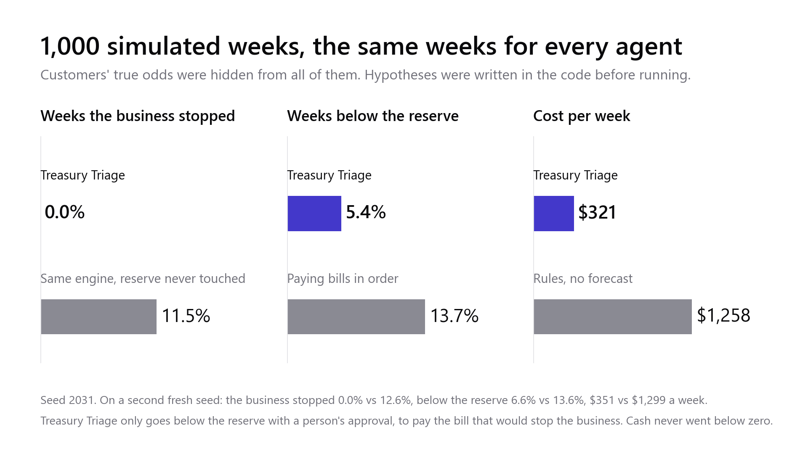
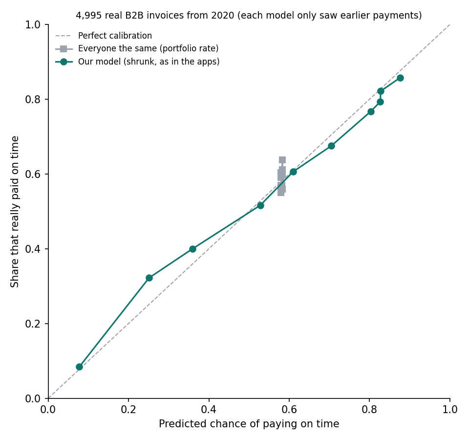

# Treasury Triage

**A treasury agent that knows how much to trust its own cash forecast.** Built for the Airwallex Agentic Banking Hackathon (Starter Kit 01, Adaptive Treasury Controller).

A founder of a small multi-currency business has five bills due in the next 72 hours, in USD, EUR and GBP, and not enough cash to pay all of them without breaking the minimum reserve. Treasury Triage decides what to **fund, convert, defer or escalate**, does it on Airwallex, and **lowers its own autonomy when its receivables forecast becomes less reliable**.

**What makes it different**
- **A forecast with odds, checked on real data.** Each customer's chance of paying on time is learned from its history; on 4,995 real business invoices it was right to within 2.6 points on average.
- **Autonomy that follows the forecast.** When this week's forecast is less reliable than usual, the agent cuts its own FX limit, and the same conversion now needs the owner.
- **Measured, not just demoed.** 1,000 simulated weeks against five other agents, with the hypotheses written before running: the business never stopped, and it cost about $940 a week less than rules with no forecast.


## For judges: try it in 2 minutes, no keys needed

```bash
pip install -r requirements.txt
python -m streamlit run panel.py
```

Without a `.env`, the app runs in **demo mode**: a built-in simulator (`simulador_airwallex.py`) answers the same Airwallex REST calls, behind the same wrapper, with the rates and fees we measured on the real sandbox. Claude's step **replays a real Claude run** (`grabacion_claude.json`): the same tool calls, checked again by code. With sandbox keys in `.env`, the same buttons move money in the Airwallex sandbox and Claude reads live.

Press the sidebar buttons in order and check what you should see:

| Step | What you should see |
|---|---|
| **2 · Claude reads the inbox** | Four invoices match; Q. Consulting's asks for an account on no supplier file, and its card shows a **payee check paid on Metal: no match** (see "On Metal" below). Globex asks for more time; the fake "CFO" email is ignored. Confidence **75%, 6 points below usual**, so the agent's FX limit drops from $10,000 to $2,500 |
| **3 · Execute the plan** | Freight paid (PAID). Both conversions now need a person: two approval cards with a locked quote. SaaS deferred, new supplier escalated |
| **Approve** both cards | They show as approved by the owner |
| **4 · Globex pays $18,000** | The agent finds the deposit in Airwallex and matches it to invoice GX-2207. Confidence 75% → 93%. *Only* the SaaS decision changes: defer → pay |
| **3 · Execute the plan** again | Conversions at the approved quotes, every bill the agent may pay is PAID, **reserve intact** (about $11,200 above the $15,000 floor). Q. Consulting still waits for a person |

**Then try another week.** The **What if?** tab runs the same planner on a different week: other balances, bills, customer emails and FX moves, at today's rates. Press **Another scenario**, or change any number, and see which decisions move and why, against the demo's week. The rules don't move: the new supplier always goes to a person, and a conversion above the agent's limit needs one. Nothing in that tab touches Airwallex, Claude or Metal.

**Proof it ran on the real sandbox:** [`evidencia/recibo_r20261029-011728.md`](evidencia/recibo_r20261029-011728.md) (29 Oct) and [`evidencia/recibo_r20261106-204646.md`](evidencia/recibo_r20261106-204646.md) (6 Nov, the round recorded for the demo video) list every conversion, transfer and deposit of a real demo round with its Airwallex id. Re-queried from Airwallex, every conversion and transfer is PAID or SETTLED (a failed £0.13 opening sweep is listed too), Globex's deposit is matched to its invoice, and the audit trail is verified.

## What it does

1. **Reads the real position from Airwallex:** balances, and the FX rate it would be charged now.
2. **Forecasts receipts with probabilities.** Each customer's chance of paying on time comes from its payment history, shrunk towards the portfolio average by empirical Bayes. 5,000 cash paths over the next 72 hours give the chance of breaking the reserve. In the 1,000-week simulation it also learns from every payment (see the evidence below); in the demo the business starts today, so there is no track record yet and nothing changes.
3. **Decides in code.** It picks the plan with the lowest expected cost whose chance of breaking the $15,000 reserve stays under 5%:
   - fund what stops the business if unpaid;
   - convert only the FX that is missing, fees included;
   - defer the cheapest bill to defer;
   - escalate policy exceptions to a person.

   **It never stops the business on its own.** If keeping the reserve would mean deferring a bill that halts operations, the plan pays just that bill from the reserve, as long as cash stays above zero, and **a person approves that payment** first.
4. **Reads supplier invoices and the inbox with Claude.** Claude records what each supplier invoice says (amount, currency, due date, bank account) and what customer emails say about payment timing. Code checks every value before it counts, and **a bill whose invoice does not match the payables list or the bank details on file goes to a person**.
5. **Ties its autonomy to forecast confidence.** In a normal week it converts up to $10,000 alone. When this week looks worse than usual for the portfolio (5+ points below the usual on-time rate), the limit drops and **the same conversion needs a person**.
6. **Binds approvals to an Airwallex quote.** The approval card shows the exact USD cost of a locked rate, and the conversion runs at that quote. A new email, a new amount or an expired quote means a new approval.
7. **Reconciles, then re-plans.** It does not take a payment for granted: it reads the deposits in Airwallex (`/api/v1/deposits`) and matches each one to an invoice it expects, by amount, currency and the customer's name or invoice number. Each deposit counts once. Only then does it reopen the decisions the new cash changes, and it shows the diff.
8. **Executes and audits.** It books the FX conversions, creates the beneficiaries and sends the supplier transfers (SCHEDULED → SENT → PAID in the sandbox), then confirms the reserve. Every operation goes to a ledger with its `request_id`, so nothing is paid or converted twice. Every change is also appended to an audit trail where each event carries the hash of the one before; `python verificar_auditoria.py` checks the chain and the ledger against it.
9. **Shows its forecast.** The screen draws the cash path of the next 72 hours with the plan: the band that holds 90% of the 5,000 simulated paths, against the reserve floor. When Globex's email arrives, the band drops towards the floor.
10. **Checks an unknown account on Metal before a person decides.** See the next section.

## On Metal: a payee check before a person decides

Q. Consulting's invoice asks to be paid into an account that is on no supplier file. Before the owner decides, the agent buys a **payee check**, like the EU's Verification of Payee: is account `LT12 1000 0111 0100 1000` registered to Q. Consulting? It pays **0.25 \*USDZ over x402 on Metal testnet** with Metal's `metal-agent` CLI. The answer goes on that bill's card as evidence: **no match**, with a link to the payment on the Metal explorer.

- **What it changes:** nothing in the plan. The bill goes to a person either way (new payee, rule R7); the check only gives that person evidence. Balances, decisions, the reserve, approvals and the audit trail are the same with and without it. A test checks that the plan, its fingerprint and Claude's briefing do not change.
- **Who is paid:** "Payee Check", a **demo service we run locally** (`metal/verificador_x402.mjs`, built on `@metalntwx/metal-pay`). Its registry is synthetic (`metal/registro_demo.json`): the four suppliers' accounts are theirs, and the account in Q. Consulting's invoice belongs to someone else. It answers match, close match (with the name on record), no match, or not possible.
- **Never pays twice:** one key per round and invoice, in a ledger of its own with the same hash-chained audit trail (`data/metal/libro_metal.json`), so the Airwallex trail and its numbers stay as they were. The agent pays only an exact \*USDZ offer, to the service's address on file, for exactly 0.25. The service charges each check once; asking again returns the stored answer for free. If the answer is lost after paying, the agent finds the payment at Metal's facilitator by its nonce instead of paying again.
- **Never stops the demo:** if Metal or the service does not answer, the card says "Payee check on Metal unavailable", and the bill still goes to a person.
- **Proof it ran:** [the real payment on the Metal explorer](https://testnet.metalntwx.com/tx/0x8d839adc481acfe18a58a3a21d2eff6bb798b2d8dad4c353caa684a57f708f98) (0.25 \*USDZ from the agent `0x7393…580f` to the service `0xA0f4…e665`, 1 Nov 2026, finalized). Without Metal set up, the demo **replays that recorded check** (`metal/grabacion_metal.json`) and says so on the card ("replay of a real Metal testnet payment"). `TT_GRABAR_METAL=1` records a new one.
- **Run it for real** (Node.js 22 or later):

  ```bash
  python metal/preparar.py --clave       # installs metal-agent and the service outside the project folder,
                                         # creates a testnet key in data/metal/ and funds it from Metal's faucet
  TT_METAL=real python -m streamlit run panel.py
  ```

  With the real Airwallex sandbox it pays for real by default; `TT_METAL=replay` or `off` changes that.
- **Ready for spending limits on chain:** `rail_metal.py` can also pay under a Metal **mandate** (`metal-agent pay --mandate`), so the owner's limits (only this service, at most 1 \*USDZ per payment, 5 in total) are enforced by the chain itself, not only by our code.

## What the model does and what the code does

| Claude (through typed tools) | Code |
|---|---|
| Reads supplier invoices and records amount, currency, due date and bank account | Checks each value is on the invoice, then compares it with the payables list and the beneficiary on file |
| Reads customer emails and records what they say about payment timing | Amounts, limits, reserve, approvals, duplicate protection, state changes |
| Explains the plan to the owner in plain English | The effect of each signal on the odds (fixed in policy, not chosen by the model) |

Claude has five tools: `read_supplier_invoices`, `record_invoice`, `read_inbox`, `record_signal` and `recompute_plan`. **None of them moves money.**

An invoice reading only counts if every value in it appears word for word on that invoice. Then code compares it with what we already know. A different amount, due date or bank account sends the bill to a person: invoice fraud usually changes only the bank details. **Payments always go to the beneficiary on file, never to an account read from an invoice.**

A signal only counts if all of these hold:
- the email comes from that customer's own domain;
- the signal is one of four allowed kinds;
- the quoted evidence appears word for word in the email.

The demo has two traps:
- a fake "CFO" email that asks to pay a new supplier immediately. The agent has no tool that could do it, and the payment still waits for a person;
- that new supplier's invoice asks for payment to an IBAN that is on no beneficiary on file, so it is flagged as well.

## Traps it handles (each one is an automated test)

| Trap | What happens | Test |
|---|---|---|
| A fake "CFO" email orders an urgent payment | Claude has no tool that pays; nothing is recorded; the payment waits for a person | `test_the_fake_cfo_email_cannot_become_a_payment_or_a_signal` |
| An invoice asks to pay a new bank account | The bill goes to a person; payments only go to the beneficiary on file | `test_changed_bank_details_send_the_bill_to_a_person` |
| Claude "reads" a value that is not on the invoice | Rejected by code; the reason goes back to Claude | `test_an_invoice_value_that_is_not_on_the_invoice_is_rejected` |
| An email from someone else's domain, or an invented quote | The signal does not count | `test_a_signal_counts_only_with_verbatim_evidence_from_the_customers_own_domain` |
| The email changes after an approval | The old approval no longer matches: a new card | `test_other_amount_or_a_new_signal_needs_a_new_approval` |
| The locked quote expires | A new quote and a new approval; an expired card is not a "no" | `test_expired_quote_needs_a_new_approval`, `test_an_expired_pending_card_is_not_a_no` |
| A pending card is treated as approved | Never: only a granted approval converts | `test_a_pending_card_is_never_used_as_an_approval` |
| The response to a conversion is lost | The wrapper finds it by `request_id` instead of converting again | `test_conversion_lost_response_returns_the_original_instead_of_converting_again` |
| A transfer went through but the reply timed out | Found by `request_id`, never paid again | `test_transfer_that_went_through_is_found_not_paid_again` |
| The sandbox answers HTTP 500 while moving a transfer | Checked and retried once; if still stuck, the next run finishes it | `test_two_500s_leave_it_in_flight_and_the_next_run_finishes_it` |
| The bought currency is not in the balance yet | It waits, and says so instead of paying | `test_if_the_money_never_shows_up_it_says_so_instead_of_paying` |
| Keeping the reserve would stop the business | Only that bill is paid from the reserve, never below zero, after a person approves | `test_a_bill_paid_from_the_reserve_never_leaves_without_a_person` |
| Someone edits, deletes or adds a ledger entry, or edits its audit trail | The hash chain or the ledger check fails (`verificar_auditoria.py`), and the agent moves no money until a person looks | `test_the_audit_trail_catches_an_edited_event_and_a_ledger_changed_by_hand` |
| A retry of a simulated deposit | Never retried blindly: it could double the money | `test_simulation_without_request_id_is_never_retried` |
| A deposit for the right amount from someone else | Not taken as the customer's payment: it needs the customer's name or the invoice number, and each deposit counts once | `test_a_deposit_counts_only_when_it_matches_the_invoice_and_only_once` |

## Evidence: 1,000 simulated weeks

The same synthetic weeks were run with six agents:
- Treasury Triage;
- the same engine that never touches the reserve, even if the business stops;
- the same engine that never learns (its forecast keeps the starting history for all 1,000 weeks);
- the same engine ignoring emails;
- a rule-based agent with no forecast, in the style of the official treasury recipe;
- paying bills in due-date order.

Customers' true on-time odds were hidden from all of them, and the hypotheses were written in the code before running (`simulacion.py`).

**The agent learns from every payment.** Each payment joins its customer's history four weeks later, once even the late ones have arrived. Every 20 weeks a self-check compares what the agent believed with what happened, and corrects the base forecast and how much an email is worth. It is a penalized logistic regression (`motor_comun/triage_core/collections_calibration.py`), shared with Receivables Copilot.



On the latest two fresh seeds (2031 and 2032):
- **The business never stopped.** The same engine that never touches the reserve stopped it in 12-13% of weeks.
- **About $940 a week cheaper** than the no-forecast agent, and **$530-$570 cheaper** than never touching the reserve. Paying in order costs less ($105-$112), but only because going below the reserve has no price in this cost.
- **Cash never went below zero.** It went below the reserve in 5-7% of weeks, against 14% when paying in order. The agent only plans to use the reserve with a person's approval, to pay the bill that would stop the business; the other dips (15% of them) were unplanned, within the risk the plan accepts. The agent knows that risk: it predicted 5.0-6.2% and it happened in 5.4-6.6% of weeks.
- **The forecast stays within 6 points** of what really happened in every bucket (on the seeds that tested learning: it was 11 points off without learning, and it closes 56-80% of the gap to a forecast that knew the hidden truth).
- With "worse than usual" approvals, it **asks a person for FX in 1 week in 4 or 5**, and those weeks really are riskier: 63-74% have a late payment, against 47-48% of the others.

**How much is left to gain from a better forecast? Nothing measurable.** We ran the same engine with a perfect forecast (each customer's true odds, emails read exactly right, the real spread of delays). It cost $322 and $360 a week on these seeds, against $321 and $351 for Treasury Triage, with the same reserve use (`techo_oraculo.py`).

**Honest misses:**
- The reserve is used in 5-7% of weeks, where before it was kept in 99%. It is a choice: we prefer that to stopping the business, and a person approves every time.
- Reading emails helps only a little: no clear effect on these two seeds.
- Learning sometimes makes it slightly bolder: on one seed in each of the last two runs, it went below the reserve 0.4 points more often than the engine that never learns.
- The per-bucket calibration test is noisy. In the diagnosis, even the hidden truth failed it on 1 seed in 5, so we added a test that does not depend on buckets.

Full write-up: `RESULTADOS_SIMULACION.md` (Spanish).

## Evidence: the payment model, checked on 4,995 real business invoices

The cash forecast rests on one model: each customer's odds of paying on time, and how late they pay when they don't. The 5,000 cash paths on screen are drawn from it. A simulation cannot show that it works on real customers. So we ran the same model (the shared engine, unchanged) on public data: the Kaggle ["Payment Date Dataset"](https://www.kaggle.com/datasets/rajattomar132/payment-date-dataset) (CC0), 50,000 invoices from a US supplier to large retailers in 2019-2020. At the start of each month, the model only saw payments made before that day. The hypotheses were written before running (`motor_comun/evaluacion_real/HIPOTESIS.md`).

On the 4,995 invoices from 2020 whose payment date is known:
- **Its on-time odds were right to within 2.6 points on average** (10 equal groups; the worst was 7 points off).
- **24% less error (Brier score) than one on-time rate for every customer.**
- **Its "latest day" held.** Payments arrived by the model's 90% day 91.8% of the time; it promised 93.2%.



**Honest misses:**
- **One hypothesis failed as written.** The pre-registered test counted invoices still marked open as late. They are not unpaid: the dataset removed the payment date of everything issued from 27 Feb 2020 (all of March to May is "open"). Counted that way, the average gap was 5.4 points and the worst group 12.7, missing our bar of 5 and 10. We report both.
- These are large retailers on mostly 15-day terms, one supplier and two test months, not small multi-currency businesses.
- It does not test FX or reading emails, because the dataset has no data on them.

Full write-up and code: `motor_comun/evaluacion_real/` (`RESULTADOS.md` in Spanish; `evaluar.py` reruns it, and the script has the CSV's link and checksum).

## What is real and what is simulated

- **Real Airwallex sandbox API calls:**
  - login;
  - balances, global accounts and beneficiaries;
  - FX rates, quotes and conversions;
  - transfers.
- **Sandbox simulations** (behind the same wrapper, `rail_airwallex.py`):
  - the customer's deposit (`simulation/deposit/create`);
  - transfer status changes (`simulation/transfers/{id}/transition`).
- **Real Metal testnet payment:** the payee check, 0.25 \*USDZ over x402 (`rail_metal.py`, through the `metal-agent` CLI and Metal's facilitator). The service it pays is a demo we run locally, with a synthetic registry.
- **Synthetic:** the business, its customers' payment histories, the supplier invoices and the emails.
- **Real data, for the payment model:** it was also checked on 4,995 real business invoices from a public dataset (see the Evidence section).
- **Demo mode (no keys):** `simulador_airwallex.py` plays the sandbox under the same wrapper, and Claude's step replays a recorded real run (recorded on the simulator, from the demo's starting balances). Claude's briefing is shown only if the plan on screen is the one Claude saw; if not (say, a customer already paid), the screen says so instead. `TT_GRABAR=1` with a Claude key records a new run. The screen says so in a banner. It keeps its own ledger (`data_simulada/`), apart from the real sandbox's.

## Run it

```bash
pip install -r requirements.txt
# .env (never committed): AIRWALLEX_CLIENT_ID, AIRWALLEX_API_KEY, AIRWALLEX_ENVIRONMENT=SANDBOX, ANTHROPIC_API_KEY
# without it, the app runs in demo mode (see "For judges" above)
python -m streamlit run panel.py
```

In the sidebar:
1. **Reset sandbox**: brings the sandbox back to $39,000 / €1,200 / £0.
2. **Claude reads the invoices and the inbox.**
3. **Execute the plan.**
4. Approve the cards.
5. **Globex pays $18,000.**
6. **Execute the plan** again.

The same steps exist on the command line: `reiniciar_demo.py`; `ejecutar_plan.py --leer-correo` (without a Claude key it replays the last real Claude run, like the screen); `aprobar.py` to list the cards and `aprobar.py <code>` to approve each one; then `ejecutar_plan.py --deposito-globex`.

Tests (offline, no keys): `python -m pytest tests motor_comun/tests` (the app and the shared engine, 147 tests). The engine lives in `motor_comun/`.

## Things the sandbox taught us

- New accounts need a scoped API key, which has its own Client ID.
- Real transfer fees differ from the guide: SWIFT is about €13.5, not €12.85, and LOCAL payouts are not free. **Airwallex keeps the fee when a transfer fails.**
- Fees move a few cents during the day (SWIFT €13.45-13.49 on the same day). Buying the exact currency failed with `balance_insufficient` when the fee rose 3 cents, so conversions now size the fee 5% higher.
- A converted or deposited amount can take a few seconds to show in the balance. The agent waits until it does before paying with it or re-planning.
- A reused `request_id` on a conversion is rejected instead of returning the original. The wrapper looks the operation up by `request_id` before treating it as failed.
- The transfer simulation can answer HTTP 500 and leave a transfer in SCHEDULED. A sent transfer counts as committed money, and the next run finishes it.
- Airwallex's own account check (`POST /api/v1/beneficiaries/verify_account`, Verification / Confirmation of Payee) gives simulated answers in the sandbox. On 2 Nov it said VERIFIED / NOT_MATCHED for Q. Consulting's account, but also for Bergmann's account on file, and INVALID for Hart & Co's. So the demo makes no decision on it. In production it would be the first check before a new payee, with the Metal check as a second, independent source. Either way, a new payee still goes to a person.

## Things Metal testnet taught us

- On 30 Oct, `npx @metalntwx/metal-agent@0.3.3` installed `@x402/fetch` 2.29.0. With that version, `pay` settled the payment and then failed with "payment in doubt". `metal/package.json` pins `@x402/*` to 2.28.0.
- x402 charges per request. A service that is paid once per item (an invoice, a check) has to remember what is paid, or a retry pays again.
- If the answer to a payment is lost, Metal's facilitator still lists the payment (`/settlements`, by payee). Its id ends in the payment's nonce, so the agent finds it there instead of paying twice.
- On Windows, Node can exit with an error code after a payment that went through, so the wrapper reads what the CLI printed, not its exit code.

## Use of AI

- **In the product:** Claude (`claude-opus-5-5`) reads supplier invoices and emails and explains the plan, as described above. It never sees API keys and cannot move money.
- **In development:** built with Claude Code as a coding assistant. The author designed the product, the decision rule and the evaluation, and reviewed and ran every step.

## Shared engine

The forecasting, approval, ledger and signal-checking engine (`motor_comun/triage_core/`) is also used by a separate product, Receivables Copilot (PayPal invoices). The products, decisions and integrations are different.

## License

MIT.
